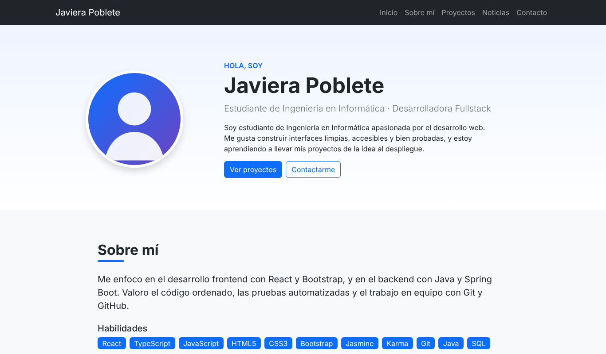
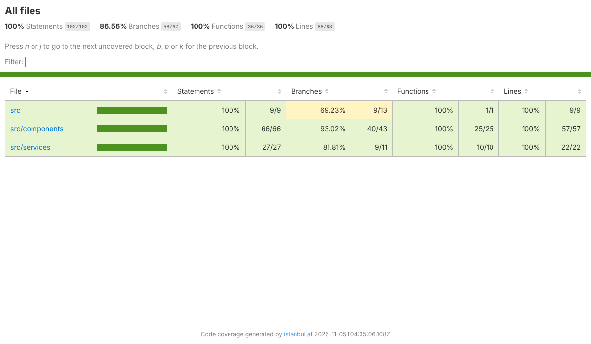
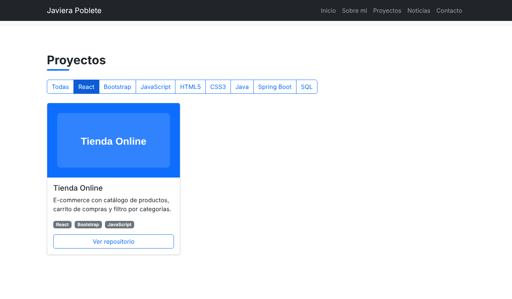
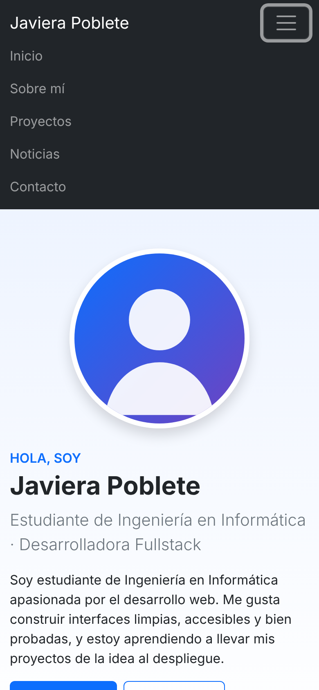
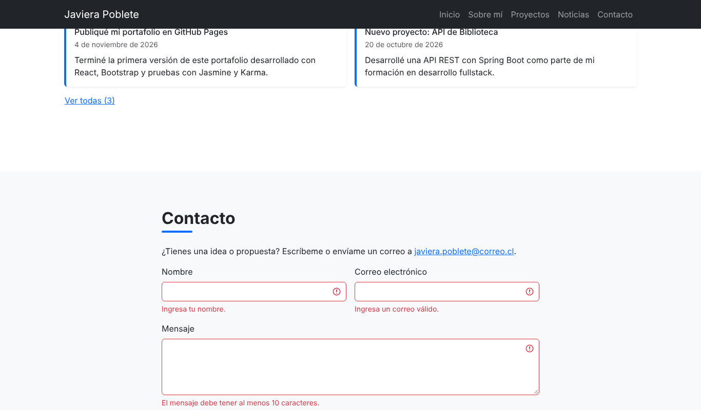

# Portafolio personal – React + Bootstrap

Portafolio personal desarrollado para la **Evaluación Formativa N° 2** de **DSY1104 – Desarrollo Fullstack II**.
Construido con **React 18 + TypeScript (TSX)**, **Bootstrap 5 / React-Bootstrap**, datos en **archivos JSON** y pruebas unitarias con **Jasmine + Karma**.

🔗 **Demo:** https://TU-USUARIO.github.io/portafolio-react/



## Características
- **Secciones:** Introducción (nombre, foto y biografía), Sobre mí, Proyectos, dos secciones de Noticias y Contacto.
- **Bootstrap:** Navbar, Card, Button, Form, Badge, Alert, Spinner y Grid System (`Container`, `Row`, `Col`).
- **Componentes personalizados reutilizables** que reciben props tipadas con interfaces de TypeScript (`src/types.ts`).
- **State y props:** filtro de proyectos por tecnología, "Ver todas" en noticias, formulario controlado con validación.
- **Datos en JSON** (`public/data`) cargados con `fetch` mediante el hook `useDatosJSON`.
- **Responsivo:** 1 columna en móvil, 2 en tablet y 3 en escritorio; menú hamburguesa en pantallas pequeñas.
- **Accesibilidad:** textos `alt`, enlace "Saltar al contenido", etiquetas en formularios, foco visible, `aria-*`.
- **Rendimiento:** imágenes SVG livianas con `loading="lazy"`, build minificado con Vite.

## Requisitos
- [Node.js](https://nodejs.org/) 18 o superior (incluye npm)

> **Windows:** si PowerShell muestra *"la ejecución de scripts está deshabilitada"*, ejecuta una vez
> `Set-ExecutionPolicy -Scope CurrentUser -ExecutionPolicy RemoteSigned` o usa `npm.cmd` en lugar de `npm`.
- Google Chrome (para ejecutar las pruebas con Karma)
- Git

## Instalación
```bash
git clone https://github.com/TU-USUARIO/portafolio-react.git
cd portafolio-react
npm install
```

## Ejecutar en modo desarrollo
```bash
npm run dev
```
Abre http://localhost:5173 en el navegador.

## Ejecutar las pruebas
```bash
npm test             # Jasmine + Karma en Chrome Headless, con informe de cobertura
npm run test:watch   # Modo observador: vuelve a ejecutar al guardar cambios
npm run test:all     # Chrome y Firefox (requiere Firefox instalado)
npm run typecheck    # Revisa los tipos de TypeScript (tsc --noEmit)
```
El informe de cobertura queda en `coverage/html/index.html`.

> Si Karma no encuentra Chrome, define la variable `CHROME_BIN` con la ruta del ejecutable.
> Windows (PowerShell): `$env:CHROME_BIN="C:\Program Files\Google\Chrome\Application\chrome.exe"`

**Resultado actual:** 45 pruebas exitosas · 100 % líneas · 86,6 % ramas.



El detalle de los casos está en [docs/PLAN_DE_PRUEBAS.md](docs/PLAN_DE_PRUEBAS.md).

## Compilar y publicar en GitHub Pages
1. Cambia `TU-USUARIO` en `package.json` (`homepage`) por tu usuario de GitHub.
2. Ejecuta:
   ```bash
   npm run deploy
   ```
   Esto compila (`vite build`) y sube la carpeta `dist` a la rama `gh-pages`.
3. En GitHub: **Settings → Pages → Branch: `gh-pages` / root**.

## Estructura del proyecto
```
portafolio-react/
├── public/
│   ├── data/          # perfil.json, proyectos.json, noticias-*.json
│   └── img/           # imágenes del portafolio
├── src/
│   ├── components/    # componentes React (.tsx)
│   ├── services/      # datosService.ts y hook useDatosJSON.ts
│   ├── types.ts       # interfaces: Perfil, Proyecto, NoticiaDatos…
│   ├── App.tsx        # componente raíz
│   ├── main.tsx       # punto de entrada
│   └── styles.css     # estilos personalizados
├── test/              # pruebas Jasmine (*.spec.tsx) y helpers
├── docs/              # plan de pruebas y capturas
├── karma.conf.cjs     # configuración de Karma
├── babel.config.cjs   # Babel (TS/TSX → JS) para las pruebas
├── tsconfig.json      # configuración de TypeScript
└── vite.config.js     # configuración de Vite
```

## Ejemplos de uso
**Agregar un proyecto:** edita `public/data/proyectos.json` y añade un objeto:
```json
{
  "id": 4,
  "titulo": "Mi nuevo proyecto",
  "descripcion": "Descripción breve.",
  "imagen": "img/mi-proyecto.png",
  "tecnologias": ["React"],
  "enlace": "https://github.com/TU-USUARIO/mi-proyecto"
}
```
**Agregar una noticia:** edita `public/data/noticias-tecnologia.json` o `noticias-personales.json` con `titulo`, `fecha` (AAAA-MM-DD) y `contenido`.

**Cambiar tu información y foto:** edita `public/data/perfil.json` y reemplaza `public/img/perfil.svg` por tu foto.

| Filtro de proyectos | Vista móvil | Validación del formulario |
|---|---|---|
|  |  |  |

## Autor
Javiera Poblete – DSY1104 Desarrollo Fullstack II
